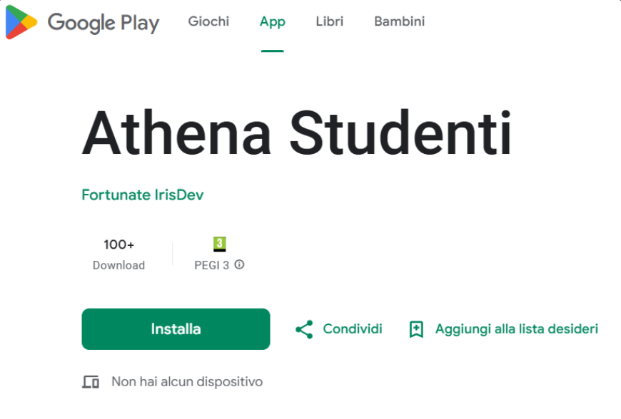
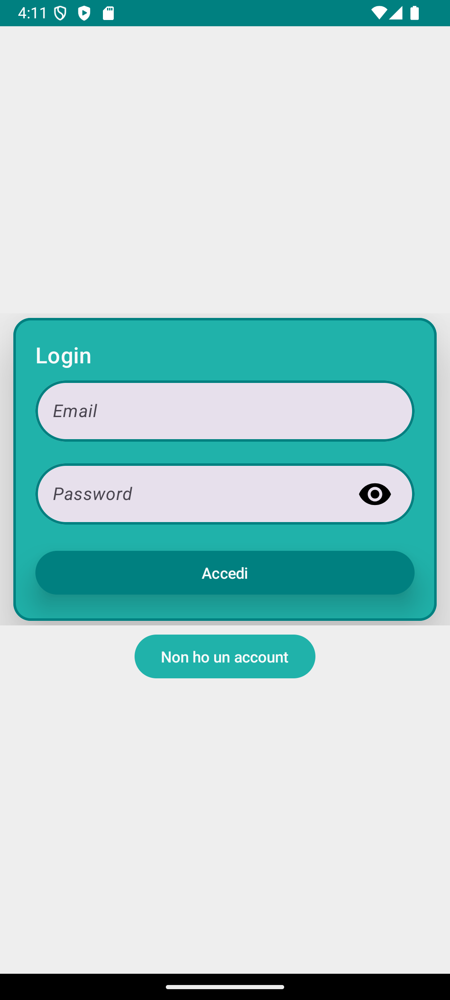
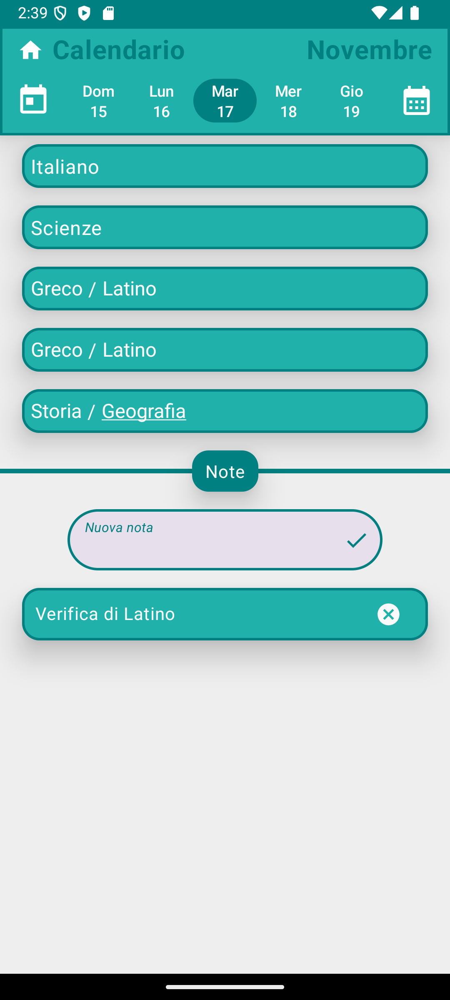
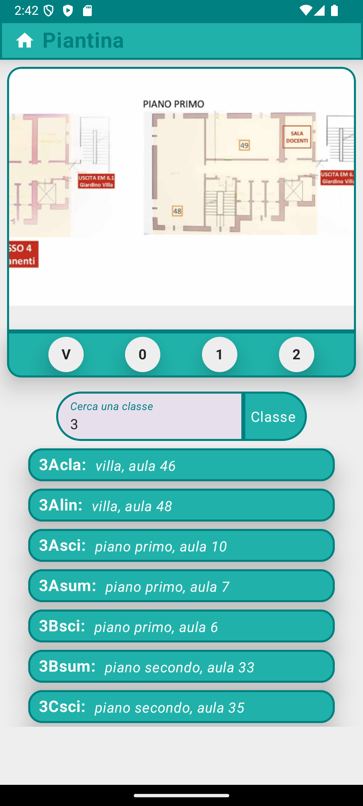
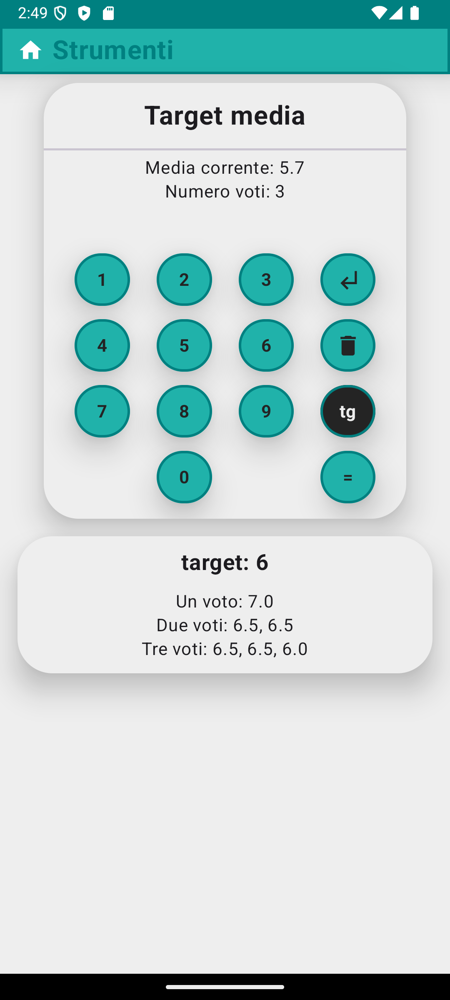

# Athena Studenti

**Athena Studenti** is a comprehensive high school companion app designed to centralize daily student life. From managing class schedules and finding classrooms to buying used textbooks and discovering local student discounts, Athena brings every essential school service into one place.

*Note: The app has been discontinued in July 2025, and is no longer available on Play Store.*

---

## Table of Contents

- [Getting Started & Login](#getting-started--login)
- [Services](#services)
  - [1. Class Calendar & Notes](#1-class-calendar--notes)
  - [2. Interactive School Map](#2-interactive-school-map)
  - [3. Target Grade Calculator](#3-target-grade-calculator)
  - [4. Student Textbook Marketplace](#4-student-textbook-marketplace)
  - [5. School Assemblies & Events](#5-school-assemblies--events)
  - [6. Local Student Promotions](#6-local-student-promotions)

---

## Getting Started & Login

To explore the app and test all available features without registering a personal school account, follow these steps using the provided demo credentials:

1. Launch the application and navigate to the **Login** screen.
2. Enter the following test account credentials:
   - **Email:** `test.account@test.it`
   - **Password:** `Testaccount1`
3. Click **Accedi** to access the main dashboard.

---

## Services

### 1. Class Calendar & Notes

Keep track of your daily and weekly class schedule at a glance. Students can view their upcoming lessons by hour and attach personal notes or homework reminders directly to specific class blocks.

---

### 2. Interactive School Map
Never get lost looking for a lab or classroom again. The interactive map lets students search for specific rooms, offices, or facilities across the school building.

---

### 3. Target Grade Calculator
Wondering what score you need on your next test to reach your goal? Input your current average along with your desired target average, and the calculator instantly computes the exact grades required on your upcoming evaluations.

---

### 4. Student Textbook Marketplace
A peer-to-peer marketplace built specifically for students. Graduating or upper-year students can list their used textbooks for sale, helping younger students find the materials they need for the school year at affordable prices.

*Note: Since the app has been discontinued, the server side no longer supports images, which won't be shown in the app.*

---

### 5. School Assemblies & Events
Stay involved in school life with a dedicated hub for assemblies and special events. Organizers can create and publish new activities, while students can browse upcoming sessions and subscribe to the ones they wish to attend.

---

### 6. Local Student Promotions
Save money around town with an updated directory of local venues, cafes, and shops offering exclusive discounts to students. Browse available deals and see where to get student perks near school.
